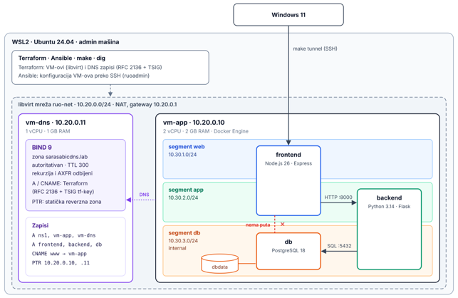

# RuO projekat

**Računarstvo u oblaku 2026/27** · Univerzitet u Zenici, Politehnički fakultet · Sara Šabić

Kompletna infrastruktura za troslojnu web aplikaciju opisana kodom: virtuelne mašine
(Terraform + libvirt), početna konfiguracija (cloud-init), konfiguracija servera (Ansible role),
kontejneri (Docker Compose), segmentirana mreža i vlastita DNS zona (BIND, DNS zapisi kao Terraform
resursi). Okruženje se podiže sa `make all`, provjerava sa `make test` i uklanja sa `make destroy`.

## 1. Aplikacija

**Emoji Movie Quiz**: igrač vidi niz emojija (npr. 🦁👑🌅), pogađa naziv filma i za tačan odgovor
dobija 10 bodova; nakon pet rundi rezultat se upisuje u rang-listu. Aplikacija je namjerno mala, ali
pokazuje cijeli tok zahtjeva **browser → frontend → backend → baza**: podnožje stranice ispisuje
koji backend kontejner je odgovorio i na kojoj bazi.

| Sloj | Tehnologija | Kontejner | Segmenti |
|---|---|---|---|
| Frontend | Node.js 26 LTS + Express 5: statična stranica i reverse proxy za `/api` | `ruo-frontend-1` | web, app |
| Backend | Python 3.14 + Flask 3.1 + gunicorn + psycopg 3: REST API | `ruo-backend-1` | app, db |
| Baza | PostgreSQL 18, imenovani volume `dbdata` | `ruo-db-1` | db |

Frontend nije samo skup statičnih fajlova: pošto je izvana dostupan jedino on, browser sve `/api`
zahtjeve šalje frontendu, a frontend ih prosljeđuje backendu. Backend je jedina komponenta koja
razgovara s bazom; prijavljuje se ulogom `quiz_app`, koja smije samo čitati filmove i čitati/upisivati
rezultate. Tablice posjeduje uloga `quiz_owner`, koja se ne može prijaviti (princip najmanjih privilegija).

| REST API | Namjena |
|---|---|
| `GET /api/health` | backend radi (koristi ga Docker HEALTHCHECK) |
| `GET /api/info` | koji kontejner je odgovorio i na kojoj bazi |
| `GET /api/puzzle?exclude=1,2` | nasumična zagonetka (emojiji i godina, bez naslova) |
| `POST /api/guess` | provjera odgovora (velika/mala slova i interpunkcija se ne računaju) |
| `GET` / `POST /api/scores` | rang-lista (top 10) / upis rezultata |

## 2. Arhitektura (stvarni raspored)



Tok zahtjeva: **browser → frontend → backend → baza**. Frontend nema mrežni put do baze.

- **Terraform** (`terraform/vm`) preko libvirt/KVM pravi vlastitu NAT mrežu `ruo-net` i dvije VM sa
  fiksnim adresama, te generiše Ansible inventory.
- **cloud-init** pri prvom pokretanju pravi korisnika `ruoadmin` sa SSH ključem; prijava lozinkom je isključena.
- **Ansible** (`config.yml`) instalira osnovne pakete na obje VM, BIND na `vm-dns` i Docker na `vm-app`;
  `deploy.yml` kopira aplikaciju na `vm-app`, gradi slike i pokreće stack.
- **Terraform** (`terraform/dns`) upisuje DNS zapise servisa u zonu na `vm-dns`.

## 3. Plan adresiranja i izolacija slojeva

| Mreža / host | Podmreža / adresa | Napomena |
|---|---|---|
| libvirt mreža `ruo-net` (NAT) | 10.20.0.0/24 | gateway 10.20.0.1 = WSL |
| `vm-app` | 10.20.0.10 | fiksna adresa preko DHCP rezervacije (Terraform varijabla `vms`) |
| `vm-dns` | 10.20.0.11 | fiksna adresa preko DHCP rezervacije; resolver svih kontejnera |
| Docker segment `web` | 10.30.1.0/24 | frontend 10.30.1.10 |
| Docker segment `app` | 10.30.2.0/24 | backend 10.30.2.10, frontend 10.30.2.20 |
| Docker segment `db` (`internal: true`) | 10.30.3.0/24 | db 10.30.3.10, backend 10.30.3.20 |

Shema: `10.20.x` su VM-ovi, `10.30.<sloj>.x` kontejneri (1 = web, 2 = app, 3 = db). Adresa `.1` je
gateway, `.10` glavna adresa kontejnera u njegovom segmentu, a `.20` njegova druga "noga" u susjednom
segmentu. Svi opsezi su privatni (RFC 1918) i ne preklapaju se s mrežama Dockera (172.17.0.0/16),
WSL-a (172.x) i podrazumijevane libvirt mreže (192.168.122.0/24).

**Način izolacije (AO-6):**

- Svaki kontejner je samo u segmentima koji mu trebaju: frontend = web + app, backend = app + db,
  baza = db. Frontend i baza nemaju zajednički segment, a Docker ne propušta saobraćaj između različitih
  mreža, pa **frontend nema mrežni put do baze**.
- Segment `db` je `internal: true`: nema gateway, pa iz njega nema izlaza.
- Objavljen je samo port frontenda (80 → 3000). Backend i baza nemaju `ports:`.
- `tests/isolation.sh` to provjerava: frontend razrješava `db.sarasabicdns.lab`, ali konekcija na port 5432 pada.

## 4. DNS zona `sarasabicdns.lab`

| Ime | Tip | Vrijednost | Ko ga upravlja |
|---|---|---|---|
| `sarasabicdns.lab` | SOA, NS | `ns1.sarasabicdns.lab.` | početni fajl zone (Ansible, rola `dns`) |
| `ns1` | A | 10.20.0.11 | početni fajl zone (Ansible) |
| `vm-app`, `vm-dns` | A | 10.20.0.10, 10.20.0.11 | Terraform (iz outputa `terraform/vm`) |
| `frontend`, `backend`, `db` | A | 10.30.1.10, 10.30.2.10, 10.30.3.10 | Terraform (plan adresiranja) |
| `www` | CNAME | `vm-app.sarasabicdns.lab.` | Terraform |
| `10.20.0.10`, `10.20.0.11` | PTR | `vm-app…`, `vm-dns…` | statička reverzna zona `0.20.10.in-addr.arpa` (Ansible, iz inventoryja) |

- BIND na `vm-dns` je samo autoritativan (`recursion no`), prenos zone (AXFR) je zabranjen, TTL je 300 s.
- Terraform zapise upisuje dinamičkim izmjenama (RFC 2136) potpisanim TSIG ključem `tf-key`
  (hmac-sha256). `update-policy { grant tf-key zonesub ANY; }` postoji samo u zoni projekta, pa isti
  ključ u reverznoj zoni dobija `REFUSED` (`tests/dns.sh`).
- Frontend i backend koriste BIND kao resolver (`dns:` u `app/compose.yaml`) i konfigurisani su
  isključivo imenima: `http://backend.sarasabicdns.lab:8000`, `db.sarasabicdns.lab`. Jedina IP adresa
  koju aplikacija dobija je adresa samog DNS servera (resolver se ne može naći po imenu); ona dolazi iz
  Terraform outputa, ne iz koda.

## 5. Struktura repozitorija

```
RuO-Projekat2026/
├── app/
│   ├── frontend/          # Node.js + Express: server.js, public/ (stranica), Dockerfile
│   ├── backend/           # Python + Flask: app.py, requirements.txt, Dockerfile
│   ├── db/init/           # SQL: uloge, šema, filmovi (izvršava se pri prvom pokretanju baze)
│   └── compose.yaml       # tri servisa, tri mreže, volume
├── terraform/
│   ├── vm/                # libvirt mreža, bazna slika, dvije VM, outputi, inventory (AO-3)
│   └── dns/               # DNS zapisi kao resursi (AO-8)
├── cloud-init/
│   └── user-data.tftpl    # korisnik ruoadmin sa SSH ključem, bez lozinke (AO-4)
├── ansible/
│   ├── ansible.cfg
│   ├── requirements.yml   # kolekcija community.docker
│   ├── config.yml         # role common, dns, docker
│   ├── deploy.yml         # rola app
│   ├── group_vars/all/    # vars.yml, vault.yml.example (vault.yml nije u Gitu)
│   └── roles/             # common, docker, dns, app (AO-5)
├── tests/                 # lib.sh, vm.sh, dns.sh, isolation.sh, app.sh, drift.sh
├── docs/                  # PDF s dizajnerskim odlukama i ADR-ovima, arhitektura.png
├── Makefile
├── .gitignore
└── README.md
```

Struktura prati preporuku iz projektnog zadatka (isječak 2). Dopune: `app/db/init/` (SQL skripte
baze), podjela Ansiblea na `config.yml` i `deploy.yml` (između njih `make dns` upisuje DNS zapise) i
`docs/`. Generisani i tajni fajlovi nisu u Gitu (`.gitignore`): `ansible/inventory.yml`,
`ansible/collections/`, `ansible/group_vars/all/vault.yml`, `.secrets/`, `*.tfstate`, `.terraform/`.

## 6. Pokretanje od praznog računara

Sve naredbe se izvršavaju u **WSL-u (Ubuntu 24.04)**, osim prve, koja se izvršava u Windows PowerShellu.

### 6.1 Priprema (jednom)

1. **WSL2 sa Ubuntu 24.04** (Windows PowerShell):
   ```powershell
   wsl --install -d Ubuntu-24.04
   ```
   VM-ovi rade unutar WSL-a, pa mora raditi ugniježđena virtualizacija: u Ubuntu `ls -l /dev/kvm` mora
   pokazati uređaj. Ako ga nema, u `%UserProfile%\.wslconfig` dodati `[wsl2]` i
   `nestedVirtualization=true`, pa u PowerShellu `wsl --shutdown`.
2. **Alati** (Terraform, libvirt/KVM, dig, nsupdate) skriptom s predmeta:
   ```bash
   git clone https://github.com/Dadyze/RuO-2026-27.git ~/RuO-2026-27
   cd ~/RuO-2026-27 && SKIP_K8S=1 ./00-setup.sh
   ```
   Zatim u PowerShellu `wsl --shutdown`, ponovo otvoriti Ubuntu i pokrenuti skriptu još jednom
   (aktivira grupe `libvirt`/`kvm` i pravi libvirt pool `default`).
3. **Ansible** (paket iz Ubuntua je prestar, zato PPA):
   ```bash
   sudo add-apt-repository --yes --update ppa:ansible/ansible && sudo apt install -y ansible
   ```
4. **Repozitorij projekta** (mora biti u `~/`, ne pod `/mnt/c`, jer Ansible tada ignoriše `ansible.cfg`):
   ```bash
   git clone https://github.com/sarasabic/RuO-Projekat2026.git ~/RuO-Projekat2026
   cd ~/RuO-Projekat2026
   ```

Docker na WSL-u nije potreban: Docker radi samo na `vm-app`, a instalira ga Ansible.

### 6.2 Podizanje, test i uklanjanje

Tačan redoslijed naredbi (iz `~/RuO-Projekat2026`):

```bash
make check     # 1. provjera alata, /dev/kvm i libvirta; pravi SSH ključ ako ne postoji
make all       # 2. podizanje: infra → config → dns → deploy (prvi put oko 15 minuta)
make test      # 3. testovi: SSH, DNS (dig), izolacija mreže, aplikacija i trajnost podataka
make all       # 4. drugo izvršavanje: bez promjena (dokaz idempotentnosti, odjeljak 9.2)
make drift     # 5. demonstracija drifta DNS zapisa (odjeljak 9.3)
make destroy   # 6. uklanjanje svega što je projekat kreirao
```

`make all` redom pokreće:

| Korak | Šta radi |
|---|---|
| `make infra` | Terraform: mreža `ruo-net`, VM-ovi `vm-app` i `vm-dns`, Ansible inventory |
| `make config` | Ansible: osnovna konfiguracija, BIND na `vm-dns`, Docker na `vm-app` |
| `make dns` | Terraform: DNS zapisi servisa |
| `make deploy` | Ansible: kopiranje aplikacije na `vm-app` i pokretanje kontejnera |

Pri prvom `make all` automatski se pokreću i `make secrets` (nasumične lozinke baze u šifrovanom
vaultu) i `make image` (preuzimanje Ubuntu slike). `make destroy` čuva vault i preuzetu sliku, pa
ponovno podizanje ide brže.

### 6.3 Pristup aplikaciji

- Iz WSL-a: `curl http://10.20.0.10/api/info`
- U Windows browseru: `make tunnel`, pa `http://localhost:8080` (mreža 10.20.0.0/24 postoji samo unutar WSL-a).

## 7. Tajne (AO-9)

| Tajna | Odakle dolazi | U Gitu? |
|---|---|---|
| lozinke baze | `make secrets` ih generiše nasumično i šifruje ansible-vaultom u `ansible/group_vars/all/vault.yml` | samo primjer `vault.yml.example` |
| lozinka vaulta | `.secrets/vault_pass`, generiše je `make secrets` | ne |
| TSIG ključ | generiše ga rola `dns` na `vm-dns` (`tsig-keygen`); Ansible ga kopira u `.secrets/tf-key.key`, `make` ga Terraformu predaje kao `TF_VAR_tsig_secret` | ne |
| privatni SSH ključ | `~/.ssh/id_ed25519` na admin mašini; u cloud-init ide samo javni ključ | ne |
| na `vm-app` | `/etc/ruo-app/app.env`, vlasnik root, mode 0600, task sa `no_log` | ne |

## 8. Ispunjenje obaveznih odluka (AO)

| AO | Kako je ispunjena | Provjera |
|---|---|---|
| AO-1 | tri kontejnera (frontend, backend, db); tok samo frontend → backend → baza | `app/compose.yaml`, `tests/isolation.sh` |
| AO-2 | sve kroz kod; podizanje i uklanjanje dokumentovanim nizom naredbi | `make destroy && make all && make test` |
| AO-3 | VM-ove pravi Terraform; parametri u `variables.tf`, adrese u `outputs.tf`, state u `.gitignore` | `make plan` → No changes |
| AO-4 | cloud-init: `ruoadmin` sa SSH ključem, `lock_passwd: true`, `ssh_pwauth: false` | `tests/vm.sh` |
| AO-5 | Ansible role `common`, `docker`, `dns`, `app`; idempotentni playbookovi | drugi `make all`: `changed=0` |
| AO-6 | segmenti web/app/db s vlastitim podmrežama, `db` internal, objavljen samo port 80 | `tests/isolation.sh` |
| AO-7 | zona `sarasabicdns.lab` na BIND-u; aplikacija koristi samo FQDN imena | `tests/dns.sh`, pretraga koda za IP adrese (ispod) |
| AO-8 | zapisi su resursi `hashicorp/dns` (RFC 2136 + TSIG); ključ ograničen na zonu projekta | `make plan`, `make drift`, `tests/dns.sh` |
| AO-9 | ansible-vault i generisane tajne; ništa tajno u Gitu | `.gitignore`, `git log -p` |
| AO-10 | imenovani volume `dbdata` | `tests/app.sh` (ponovno kreiranje kontejnera baze) |

Pretraga koda aplikacije za IP adrese (AO-7):

```
$ grep -rnE '([0-9]{1,3}\.){3}[0-9]{1,3}' app/frontend app/backend --include='*.js' --include='*.py' --include='*.html' || echo "no IP addresses in the app code"
no IP addresses in the app code
```

## 9. Izlazi

### 9.1 Testovi (izolacija, dig upiti, provjera aplikacije)

Izlaz skripti `tests/vm.sh`, `tests/dns.sh`, `tests/isolation.sh` i `tests/app.sh` (iste skripte pokreće `make test`):

```
== AO-4: SSH prijava samo ključem
  vm-app: prijava kao ruoadmin SSH ključem               allowed  (očekivano: allowed) ok
  vm-app: ponuđeni načini prijave          Permission denied (publickey)  (očekivano: Permission denied (publickey)) ok
  vm-app: sshd PasswordAuthentication        passwordauthentication no      (očekivano: passwordauthentication no) ok
  vm-dns: prijava kao ruoadmin SSH ključem               allowed  (očekivano: allowed) ok
  vm-dns: ponuđeni načini prijave          Permission denied (publickey)  (očekivano: Permission denied (publickey)) ok
  vm-dns: sshd PasswordAuthentication        passwordauthentication no      (očekivano: passwordauthentication no) ok

== AO-7: zapisi koje daje BIND na vm-dns (10.20.0.11), zona sarasabicdns.lab
  ns1.sarasabicdns.lab           A      10.20.0.11
  vm-app.sarasabicdns.lab        A      10.20.0.10
  vm-dns.sarasabicdns.lab        A      10.20.0.11
  frontend.sarasabicdns.lab      A      10.30.1.10
  backend.sarasabicdns.lab       A      10.30.2.10
  db.sarasabicdns.lab            A      10.30.3.10
  www.sarasabicdns.lab           CNAME  vm-app.sarasabicdns.lab.
  sarasabicdns.lab               NS     ns1.sarasabicdns.lab.
  sarasabicdns.lab               SOA    ns1.sarasabicdns.lab. hostmaster.sarasabicdns.lab. 9 3600 600 1209600 300
  10.20.0.10                     PTR    vm-app.sarasabicdns.lab.
  10.20.0.11                     PTR    vm-dns.sarasabicdns.lab.

== DNS odgovori odgovaraju stvarnim adresama
  vm-app.sarasabicdns.lab = Terraform output 10.20.0.10                     (očekivano: 10.20.0.10) ok
  vm-dns.sarasabicdns.lab = Terraform output 10.20.0.11                     (očekivano: 10.20.0.11) ok
  frontend.sarasabicdns.lab = adresa kontejnera 10.30.1.10                     (očekivano: 10.30.1.10) ok
  backend.sarasabicdns.lab = adresa kontejnera 10.30.2.10                     (očekivano: 10.30.2.10) ok
  db.sarasabicdns.lab = adresa kontejnera    10.30.3.10                     (očekivano: 10.30.3.10) ok

== Kontejneri razrješavaju imena preko našeg BIND-a
  frontend razrješava backend.sarasabicdns.lab 10.30.2.10                     (očekivano: 10.30.2.10) ok
  backend razrješava db.sarasabicdns.lab    10.30.3.10                     (očekivano: 10.30.3.10) ok

== Server je isključivo autoritativan
  upit za tuđi domen (example.com)          REFUSED                        (očekivano: REFUSED) ok
  prenos zone (AXFR) za sarasabicdns.lab                  blocked  (očekivano: blocked) ok

== AO-8: TSIG ključ smije mijenjati SAMO zonu projekta
  tf-key: dodaj TXT zapis u sarasabicdns.lab              allowed  (očekivano: allowed) ok
  tf-key: dodaj PTR zapis u 0.20.10.in-addr.arpa          blocked  (očekivano: blocked) ok

== Izvana (WSL = "internet" ovog laba)
  WSL -> vm-app:80    frontend (objavljen port)           allowed  (očekivano: allowed) ok
  WSL -> vm-app:8000  port backenda                       blocked  (očekivano: blocked) ok
  WSL -> vm-app:5432  port baze                           blocked  (očekivano: blocked) ok
  WSL -> direktno na backend kontejner                    blocked  (očekivano: blocked) ok
  WSL -> direktno na db kontejner                         blocked  (očekivano: blocked) ok

== Između slojeva (unutar vm-app)
  frontend -> backend.sarasabicdns.lab:8000               allowed  (očekivano: allowed) ok
  frontend razrješava db.sarasabicdns.lab (DNS radi...)  allowed  (očekivano: allowed) ok
  frontend -> db.sarasabicdns.lab:5432 (...ali nema mrežnog puta) blocked  (očekivano: blocked) ok
  backend  -> db.sarasabicdns.lab:5432                    allowed  (očekivano: allowed) ok
  db       -> internet (segment db je internal)           blocked  (očekivano: blocked) ok

== Aplikacija odgovara na http://10.20.0.10
  GET /  HTTP status                         200                            (očekivano: 200) ok
  naslov stranice                            Emoji Movie Quiz               (očekivano: Emoji Movie Quiz) ok
  GET /api/info   -> {"backend":"f7a06e0e025f","database":"PostgreSQL 18.7","db_host":"db.sarasabicdns.lab"}
  GET /api/puzzle -> {"emojis":"🦓🦁🦒🦛","id":22,"year":2005}
  backend do baze dolazi DNS imenom          db.sarasabicdns.lab            (očekivano: db.sarasabicdns.lab) ok

== AO-10: podaci preživljavaju ponovno kreiranje kontejnera baze
  POST /api/scores (test-153345)             201                            (očekivano: 201) ok
  ponovno kreiram db kontejner (docker compose up --force-recreate db)...
  id kontejnera: 4a3bd5d8c965 -> 7cca1ff5ec27
  db kontejner je novi                       yes                            (očekivano: yes) ok
  rezultat je i dalje u bazi                 1                              (očekivano: 1) ok
  aplikacija odgovara i nakon toga           200                            (očekivano: 200) ok
```

### 9.2 Idempotentnost: drugo izvršavanje (`make all`)

Na sistemu koji je upravo podignut, drugi `make all` ne mijenja ništa: oba Terraform koraka javljaju
da nema promjena, a Ansible playbookovi završavaju sa `changed=0`.

```
[ZALIJEPI OVDJE izlaz naredbe:  grep -E -A3 'PLAY RECAP|No changes|Apply complete' docs/outputs/03-make-all-drugi.txt]
```

### 9.3 Drift DNS zapisa

Zapis `db.sarasabicdns.lab` kojim upravlja Terraform mijenja se mimo koda (`nsupdate` sa
10.30.3.10 na 10.30.3.99), kao kad bi ga neko ručno promijenio. `terraform plan` otkriva razliku
(`~ update in-place`, izlazni kod 2), a `terraform apply` vraća stvarnost na stanje iz koda.
Pokretanje: `make drift` (`tests/drift.sh`).

```
== 1. Trenutno stanje
  db.sarasabicdns.lab -> 10.30.3.10

== 2. DRIFT: neko ručno mijenja zapis (nsupdate), mimo koda
  db.sarasabicdns.lab -> 10.30.3.99   <- aplikacija bi sad tražila bazu na pogrešnom mjestu

== 3. terraform plan otkriva razliku između koda i stvarnosti
data.terraform_remote_state.vm: Reading...
data.terraform_remote_state.vm: Read complete after 0s
dns_cname_record.www: Refreshing state... [id=www.sarasabicdns.lab.]
dns_a_record_set.service["db"]: Refreshing state... [id=db.sarasabicdns.lab.]
dns_a_record_set.service["backend"]: Refreshing state... [id=backend.sarasabicdns.lab.]
dns_a_record_set.vm["vm-app"]: Refreshing state... [id=vm-app.sarasabicdns.lab.]
dns_a_record_set.service["frontend"]: Refreshing state... [id=frontend.sarasabicdns.lab.]
dns_a_record_set.vm["vm-dns"]: Refreshing state... [id=vm-dns.sarasabicdns.lab.]

Terraform used the selected providers to generate the following execution plan. Resource actions are
indicated with the following symbols:
  ~ update in-place

Terraform will perform the following actions:

  # dns_a_record_set.service["db"] will be updated in-place
  ~ resource "dns_a_record_set" "service" {
      ~ addresses = [
          - "10.30.3.99",
          + "10.30.3.10",
        ]
        id        = "db.sarasabicdns.lab."
        name      = "db"
        # (2 unchanged attributes hidden)
    }

Plan: 0 to add, 1 to change, 0 to destroy.

  izlazni kod plana (2 = ima promjena)       2                              (očekivano: 2) ok

== 4. terraform apply vraća stvarnost na stanje iz koda
Apply complete! Resources: 0 added, 1 changed, 0 destroyed.
  db.sarasabicdns.lab nakon apply            10.30.3.10                     (očekivano: 10.30.3.10) ok
```

## 10. Verzije

| Komponenta | Verzija |
|---|---|
| Admin mašina | Windows 11 + WSL2, Ubuntu 24.04.5 LTS |
| Terraform | 1.17.2; provideri `dmacvicar/libvirt` 0.8.3, `hashicorp/local` 2.9, `hashicorp/dns` 3.6 |
| Ansible | ansible-core 2.21 (PPA `ansible/ansible`), kolekcija `community.docker` 5.x |
| VM-ovi | Ubuntu 24.04 LTS cloud image (noble) |
| Docker na `vm-app` | Docker Engine 29.10, Compose v5.8 (službeni Docker apt repozitorij) |
| DNS | BIND 9 iz Ubuntu 24.04 |
| Aplikacija | Node.js 26 LTS, Express 5.3.0, Python 3.14, Flask 3.1.3, gunicorn 27.0.1, psycopg 3.3.9, PostgreSQL 18.7 |

## 11. Polazni kod s predmeta

Primjeri iz [repozitorija predmeta](https://github.com/Dadyze/RuO-2026-27) korišteni su kao polazna
tačka i prilagođeni projektu:

| Primjer | Korišten za |
|---|---|
| `s2/p3` (Terraform + libvirt, `for_each`) | `terraform/vm/main.tf` |
| `s2/p3`, `s3/p3` (cloud-init) | `cloud-init/user-data.tftpl` |
| `s3/p3` (inventory kao Terraform resurs, čekanje cloud-inita) | `local_file.inventory`, `pre_tasks` u `ansible/config.yml` |
| `s3/p4` (multi-stage Dockerfile, healthcheck, volume, neobjavljen port) | `app/backend`, `app/compose.yaml` |
| `s3/p4-rjesenje` (reverse proxy ispred aplikacije) | `app/frontend/server.js` |
| `s4/p3` (matrica povezivosti s očekivanim rezultatom) | `tests/isolation.sh`, `tests/lib.sh` |
| `s5/p1` (BIND, TSIG, `update-policy`, fajlovi zona) | `ansible/roles/dns` |
| `s5/p2` (provider `hashicorp/dns`, drift sa `nsupdate`) | `terraform/dns`, `tests/drift.sh` |
| `s6/p3` (vlasnička i aplikacijska uloga baze) | `app/db/init/` |
| `Makefile` s predmeta (prefiks `>`, banneri) | `Makefile` |